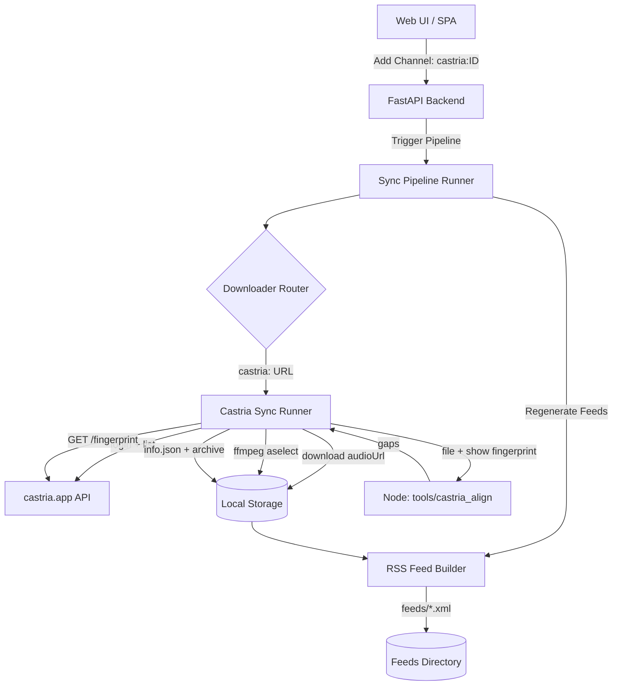

# Castria Ad-Skip Integration Design Document

This document describes extending PodQueue with a `castria:` source: instead of
re-publishing a feed verbatim, PodQueue pulls episodes from the Castria service
(`https://castria.app`), removes the ads using **Castria's own alignment
engine**, and publishes the result through PodQueue's existing RSS pipeline. Any
podcast player (Overcast, Pocket Casts, Apple Podcasts, ...) then plays the
show ad-free.

---

## 1. Objectives

- Let the user listen to ad-free versions of podcasts they already track in
  Castria, inside their preferred podcast app.
- Remove ads **accurately**. Podcast hosts commonly perform *dynamic ad
  insertion* (DAI), so the ad timings the Castria server reports do **not**
  reliably match the audio a client downloads.
- Reuse PodQueue's downloader / cleanup / RSS pipeline with minimal new code.
- Stay within the Oracle Cloud Always Free footprint (1 GB RAM, 2 cores).
- Keep the ad-removal step sequential and memory-bounded.

---

## 2. Why `adSegments` alone is not enough

`GET /api/episodes/{id}` returns `adSegments: [{startSeconds, endSeconds,
confidence, label, transcriptText}, ...]`. Those timestamps are measured against
**Castria's copy** of the episode, and the copy a client receives can differ.
Measured on a real episode:

| | Server (`adSegments`) | Our downloaded file |
|---|---|---|
| duration | 593 s (metadata) | 914.7 s (actual) |
| pre-roll | `0.56 – 72.59` | ≈ `0 – 160.4` |

The feed URL resolves through Omny/Triton ad servers
(`…/media-session/<uuid>/…&starship-episode-id=…`) and pages differ per client,
so splicing at `0.56–72.59` would leave ~88 s of ads behind. This is the exact
problem Castria's fingerprint alignment solves, so we run *their* aligner rather
than trust `adSegments`.

---

## 3. Core Architecture



---

## 4. Detailed Component Modifications

### A. New module — `podqueue/core/castria.py`

- **URL helpers**
  - `is_castria_url(url)` -> `url.startswith("castria:")`.
  - `parse_castria_target(url)` -> `("id", <subscriptionId>)` for a UUID target,
    else `("url", <value>)` (original feed URL, or show title) which is resolved
    against `GET /api/subscriptions`.
- **`CastriaClient`** — thin API wrapper with a process-lifetime access-token
  cache keyed by `(base_url, email)`, automatic re-login on `401`, and a
  configurable `X-App-Version` header:
  - `get_subscriptions()`, `get_episodes(subscription_id, page_size)`,
    `get_episode(id)`, `get_fingerprint(id)`,
    `get_skipplan(id, file_hash, algo=2)`, `resolve_subscription(kind, value)`.
- **`run_castria_download(channel, force)`** — mirrors `run_pawchive_download`:
  interval check, dir setup, artifact/leftover cleanup, archive read, episode
  enumeration, per-episode processing, then re-cleanup and last-check write.
- **Ad-gap resolution per episode** (`_resolve_gaps`), in priority order:
  1. **Crowd skip-map** — `sha256(file)` then `GET …/showskip?hash=…&algo=2`.
     Free and exact when another client already submitted a plan for these bytes.
  2. **Local alignment** — `GET …/fingerprint` then run the vendored engine
     (`podqueue/utils/castria_align.py` -> `tools/castria_align/align.mjs`).
  3. **Raw `adSegments` fallback** — only if `CASTRIA_ALLOW_TIMESTAMP_FALLBACK`
     is set; logged as potentially wrong.
- **Cut** — `cut_audio_segments()` in `podqueue/utils/media.py` re-encodes with
  ffmpeg, dropping the gap ranges:
  `aselect='not(between(t,a,b)+…)'`, `asetpts=N/SR/TB`, `libmp3lame`.
- **Metadata** — writes the standard `{id}.info.json` (`title`, `description`,
  `upload_date`, `timestamp`, `duration`, `channel`, `thumbnails`) plus a
  `castria` block recording the source, gaps, and removed seconds. Appends
  `castria <episodeId>` to `archive.txt`.
- **Readiness gate** — episodes are only downloaded once Castria has a
  fingerprint (or `adStatus == "completed"`); otherwise they are retried next
  run rather than published with ads.

### B. Node aligner — `tools/castria_align/`

- Vendors Castria's own `castria_adskip_wasm_bg.wasm` and its wasm-bindgen glue
  (see `tools/castria_align/README.md` for provenance).
- `align.mjs` streams the local file through `FingerprintSession`, then calls
  `detect_ads(showFingerprint, clientFingerprint)` and prints `{gaps, blocks}`.
- Wrapped for Python by `podqueue/utils/castria_align.py` (`run_aligner`).
- The per-run wall-clock budget is
  `max(CASTRIA_ALIGN_TIMEOUT_SECONDS, duration * ALIGN_TIMEOUT_PER_AUDIO_SECOND)`
  with a factor of 3, so a multi-hour episode is not cut off mid-alignment (a
  fixed 1 h cap silently published a 2.8 h episode with its ads).
- The Node process runs under `nice -n 10` so one long alignment cannot starve
  the web UI or SSH on a single-box host.

### C. Router — `podqueue/core/downloader.py`

- Add `if is_castria_url(channel.url): run_castria_download(...)` alongside the
  existing Pawchive branch in `run_download_job()`.

### D. Config — `podqueue/config.py` + `.env.example`

- `CASTRIA_BASE_URL`, `CASTRIA_EMAIL`, `CASTRIA_PASSWORD`,
  `CASTRIA_APP_VERSION`, `CASTRIA_NODE_BIN`, `CASTRIA_ALIGN_ENABLED`,
  `CASTRIA_ALIGN_TIMEOUT_SECONDS`, `CASTRIA_ALLOW_TIMESTAMP_FALLBACK`.
- `CASTRIA_ALIGN_TOOL` derived from `ROOT_DIR / tools / castria_align / align.mjs`.

### E. RSS / cleanup

- **No changes required.** `rss.py` already scans `*.m4a`/`*.mp3`, reads the
  standard `info.json` fields, and sorts by `upload_date`; `cleanup_old_episodes`
  bounds the episode count. Feed artwork is served from
  `data/artwork/<channel_id>.jpg`, which the runner caches from the show image.

### F. Web UI — `static/`

- The Add Channel modal accepts `castria:` sources (its source field was
  `type=url`, which silently rejected them) and offers a **Load** button beside
  it that lists the account's Castria shows and fills in
  `castria:<subscriptionId>`, pre-filling a slugged feed id.
- Channel cards show a Castria icon, the show target, and
  `Ads: Removed (Castria aligner)` in place of the SponsorBlock row.
- Backed by `GET /api/castria/subscriptions` (authenticated), which trims the
  upstream subscription objects to `id/title/url/imageUrl/episodeCount`.

---

## 5. Channel URL forms

| URL | Behaviour |
|---|---|
| `castria:<subscriptionId>` | Direct; e.g. `castria:c7e1e018-…` |
| `castria:<feed url>` | Matched against the original feed URL of your subscriptions |
| `castria:<title>` | Matched by show title as a last resort |

Example (API/curl):

```bash
curl -X POST http://localhost:8000/api/channels \
  -H 'Content-Type: application/json' \
  -d '{"id":"knowledge-fight-country","url":"castria:c7e1e018-6f86-4d53-94de-3c69990ccb7c","limit":5,"check_interval_hours":6}'
```

---

## 6. Verification & Testing Plan

1. **Unit / integration tests** (`tests/test_castria.py`): URL parsing, gap
   coercion, readiness gating, missing-credentials guard, end-to-end run with a
   faked client/HTTP/aligner verifying the cut replaces the original, the
   archive is written, and `info.json` matches the schema; plus a router test in
   `run_download_job`. Media helpers covered in `tests/test_media.py`.
2. **Engine validation (manual)** — run `align.mjs` against a real episode and
   confirm the gaps match the audio (verified: engine reported
   `gaps = [[0,160.4],[728.18,911.01]]` for a file whose server `adSegments`
   said pre-roll `0.56–72.59`).
3. **ffmpeg validation (manual)** — confirm the output duration equals input
   minus the removed ranges (verified: 914.7 s -> 571.4 s).
4. **Deployment** — Node.js and ffmpeg are already present on the target host;
   run a `castria:` channel and inspect the generated feed in the target player.

---

## 7. Risks & Notes

- **Server dependency** — the source depends on Castria's API and your account.
  The documented `X-App-Version` gate (`minAndroidBuild`) applies to the
  transcript-upload path, not the fingerprint endpoints used here.
- **Terms of service** — driving Castria's API from an unofficial client is
  likely against their terms; that is the operator's call.
- **Redistribution** — PodQueue feeds are served publicly by default. Publishing
  ad-stripped audio of a third-party podcast is redistribution; keep the feed
  private/tokenised if you only need it for yourself.
- **CPU** — alignment is CPU-bound (single Node process); downloads and ffmpeg
  are sequential, consistent with PodQueue's existing resource budget. Measured
  on the Oracle AMD micro VM, an episode takes roughly `duration / 5` seconds to
  align under load, so a 2.8 h episode needs ~30–60 min. The aligner is `nice`d
  and the timeout scales with episode length.
- **Failure is explicit** — if alignment cannot complete (e.g. the engine times
  out), the episode is published unchanged and `info.json` records
  `castria.adSource == "failed"`, rather than reporting a misleading "no ads
  found".
